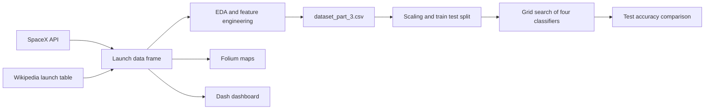

<div align="center">

# Falcon 9 Landing Prediction

**IBM Data Science capstone: collect SpaceX launch data, explore it, map it, and predict whether a Falcon 9 first stage will land successfully.**

[](LICENSE)


</div>

SpaceX can reuse the first stage of its Falcon 9 rocket, which is the main reason a launch costs less than with other providers. Whether the first stage lands is therefore a key question. This repository contains the notebooks, the data and the dashboard of the capstone project of the IBM Data Science Professional Certificate (Coursera): data collection from an API and from web scraping, exploratory analysis, interactive maps, a Plotly Dash dashboard and four classification models.

> This project is coursework from the IBM Data Science Professional Certificate (Coursera). See [NOTICE](NOTICE): the MIT licence covers the author's own code, while course materials and datasets provided by IBM remain under their original terms.

## Table of Contents

- [Overview](#overview)
- [Key Features](#key-features)
- [How It Works](#how-it-works)
- [Tech Stack](#tech-stack)
- [Project Structure](#project-structure)
- [Dataset](#dataset)
- [Getting Started](#getting-started)
- [Usage](#usage)
- [Methodology and Results](#methodology-and-results)
- [Notes and Limitations](#notes-and-limitations)
- [Acknowledgements](#acknowledgements)
- [License](#license)
- [Author](#author)

## Overview

The goal is a binary classifier for the column `Class` (1 if the first stage landed successfully, 0 otherwise) built from launch features such as payload mass, orbit, launch site, number of flights of the booster, grid fins, legs, reuse and block version. The work is split into five notebooks that follow the course labs, a Dash application and a project presentation.

## Key Features

- **Data collection from the SpaceX API:** requests to the launches, rockets, launchpads, payloads and cores endpoints, flattened into a pandas data frame.
- **Web scraping:** extraction of the Falcon 9 launch table from a fixed snapshot of a Wikipedia page with `requests` and `BeautifulSoup`.
- **Exploratory data analysis:** plots of flight number, payload mass, launch site, orbit and year against landing outcome.
- **Feature engineering:** one-hot encoding of orbit, launch site, landing pad and booster serial, all columns cast to `float64` and saved as `dataset_part_3.csv`.
- **Interactive map analysis with Folium:** launch site markers, success and failure markers in clusters and distances from launch sites to nearby points of interest.
- **Dashboard:** a Plotly Dash app with a launch site dropdown, a payload range slider, a pie chart and a payload against outcome scatter plot.
- **Model comparison:** logistic regression, support vector machine, decision tree and k-nearest neighbours, each tuned with a 10-fold grid search.

## How It Works



## Tech Stack

| Area | Technology |
|------|------------|
| Language | Python 3 |
| Data handling | pandas, NumPy |
| Data collection | requests, BeautifulSoup |
| Visualisation | Matplotlib, seaborn, Folium, geopy |
| Dashboard | Plotly Dash, Plotly Express |
| Machine learning | scikit-learn (`StandardScaler`, `GridSearchCV`, `LogisticRegression`, `SVC`, `DecisionTreeClassifier`, `KNeighborsClassifier`) |
| Environment | Jupyter Notebook (the course labs were written for a browser-based Jupyter environment) |

## Project Structure

```text
.
├── jupyter-labs-spacex-data-collection-api.ipynb   # Lab 1: SpaceX API requests and data wrangling
├── jupyter-labs-webscraping.ipynb                  # Lab 2: Wikipedia web scraping with BeautifulSoup
├── edadataviz.ipynb                                # Lab 3: EDA, feature engineering and dummy variables
├── lab_jupyter_launch_site_location.ipynb          # Lab 4: Folium interactive maps and distances
├── SpaceX_Machine Learning Prediction_Part_5.ipynb # Lab 5: classification models and comparison
├── spacex_dash_app.py                              # Plotly Dash dashboard for the launch records
├── dash_interactivity                              # Course example of a Dash app (flight delay statistics)
├── dataset_part_3.csv                              # One-hot encoded features, 90 launches
├── ds-capstone-template-coursera.pptx              # Capstone presentation (47 slides)
├── requirements.txt                                # Pinned versions from the course environment (see notes)
├── NOTICE
├── LICENSE
└── README.md
```

## Dataset

| Source | Used for |
|--------|----------|
| [SpaceX REST API v4](https://api.spacexdata.com/v4/launches/past) | Past launches, with rocket, launchpad, payload and core details (notebook 1) |
| [Wikipedia: List of Falcon 9 and Falcon Heavy launches](https://en.wikipedia.org/wiki/List_of_Falcon_9_and_Falcon_Heavy_launches) | Launch records scraped from a fixed 9 June 2021 revision (notebook 2) |
| `dataset_part_2.csv` (course storage, loaded by notebooks 3 and 5) | Wrangled launch data with the `Class` label |
| `spacex_launch_geo.csv` (course storage, loaded by notebook 4) | Launch records with site coordinates |
| `spacex_launch_dash.csv` (course storage) | Input of the Dash app; this file is not included in the repository |

The notebooks restrict launches to dates up to 13 November 2020. The repository includes `dataset_part_3.csv`, the engineered feature table (90 rows). The course data files are downloaded by the notebooks from URLs in the notebooks themselves.

## Getting Started

### Prerequisites

- Python 3 with `pip`
- Internet access, because the notebooks read data from the SpaceX API, Wikipedia and the course storage

### Installation

```bash
git clone https://github.com/LargoLujan/falcon9-landing-prediction-ibm-capstone.git
cd falcon9-landing-prediction-ibm-capstone
python -m venv .venv
source .venv/bin/activate        # On Windows: .venv\Scripts\activate
pip install pandas numpy matplotlib seaborn scikit-learn requests beautifulsoup4 folium geopy dash plotly jupyter
```

The file `requirements.txt` pins the versions of the original course environment (for example pandas 1.3.3 and scikit-learn 0.24.2), and its last line (`seaborn==0.`) is incomplete, so installing the packages above is the simplest route on a current Python.

### Running

```bash
jupyter notebook
```

Open the notebooks in the order of the structure above. Several cells use `piplite` and `from js import fetch`, which only work inside a browser-based JupyterLite environment; when running locally, replace them with a normal `pip install` and `pd.read_csv(<url>)` using the URL given in the same cell.

## Usage

### Dashboard

The Dash app reads `spacex_launch_dash.csv` from the working directory. Put that file (from the course data storage) next to the script, then run:

```bash
python spacex_dash_app.py
```

The app starts a local development server (Dash serves on `http://127.0.0.1:8050` by default). The controls are:

| Control | Behaviour |
|---------|-----------|
| Launch site dropdown | Options: all sites, CCAFS SLC 40, KSC LC 39A and VAFB SLC 4E |
| Pie chart | For all sites, share of successful launches per site; for one site, success against failure counts |
| Payload range slider | Filters the scatter plot by payload mass between 0 and 10,000 kg |
| Scatter plot | Payload mass against launch outcome, coloured by booster version |

The script imports `dash_core_components` and `dash_html_components`, which are available in Dash 2.x (the version pinned in `requirements.txt`).

The file `dash_interactivity` is an example from a course lab: a Dash app for flight delay statistics that reads an airline data set. It is not part of the SpaceX analysis.

## Methodology and Results

**Data preparation (notebooks 1 to 3).** Launches with several cores or payloads are dropped, the date is restricted to launches up to 13 November 2020, and booster, payload, launch site and core attributes are fetched from the API. After exploring the data, the features `FlightNumber`, `PayloadMass`, `Orbit`, `LaunchSite`, `Flights`, `GridFins`, `Reused`, `Legs`, `LandingPad`, `Block`, `ReusedCount` and `Serial` are selected and the categorical columns (`Orbit`, `LaunchSite`, `LandingPad`, `Serial`) are one-hot encoded.

**Observations written in the EDA notebook.** As the flight number grows, successful landings become more frequent; the success rate by year increases from 2013 until 2020; VAFB SLC launches no heavy payloads above 10,000 kg; for heavy payloads, landings are more often successful for polar, LEO and ISS orbits, while GTO shows both outcomes.

**Modelling (notebook 5).** The 90 samples are standardised with `StandardScaler` and split 80 / 20 with `random_state=2`, which leaves 18 test samples. Each model is tuned with `GridSearchCV` (`cv=10`). Figures below come from the saved notebook outputs:

| Model | Best parameters found | Cross-validation accuracy | Test accuracy |
|-------|-----------------------|---------------------------|---------------|
| Logistic regression | `C=0.01`, L2, lbfgs | 0.846 | 0.833 |
| SVM | `C=1.0`, `gamma=0.0316`, sigmoid kernel | 0.848 | 0.833 |
| Decision tree | entropy, `max_depth=4`, `max_features=sqrt`, `min_samples_split=5`, random splitter | 0.863 | 0.833 |
| K-nearest neighbours | `n_neighbors=10`, `p=1` | 0.848 | 0.833 |

All four models reach the same test accuracy of 0.833 (15 of 18 correct). The decision tree has the highest cross-validation score. For logistic regression, the notebook comments on the confusion matrix: 12 true positives and 3 false positives, so the errors are launches predicted to land that did not.

## Notes and Limitations

- With only 18 test samples, a difference of one prediction changes accuracy by about 5.6 points, so the four models cannot be told apart on the test set.
- In the decision tree grid, the value `max_features='auto'` is rejected by the scikit-learn version used in the saved run (3,240 of 6,480 fits failed and were scored as missing), but the search still completed with the valid combinations.
- The notebooks are course labs with provided scaffolding; the author completed the tasks within them.
- The Dash app depends on a data file that is not in the repository.

## Acknowledgements

- IBM Skills Network and the IBM Data Science Professional Certificate on Coursera for the lab material, the data storage and the project brief.
- The maintainers of the open SpaceX API and the contributors to the Wikipedia launch list.

## License

Distributed under the MIT License. See [LICENSE](LICENSE) for details. See also [NOTICE](NOTICE): this repository contains coursework from the IBM Data Science Professional Certificate (Coursera); the MIT licence covers the author's own code, while course materials and datasets provided by IBM remain under their original terms.

## Author

**Manuel Luján Vílchez** — Senior Data Engineer

[](https://github.com/LargoLujan)
[](https://www.linkedin.com/in/manuel-lujan-vilchez)
